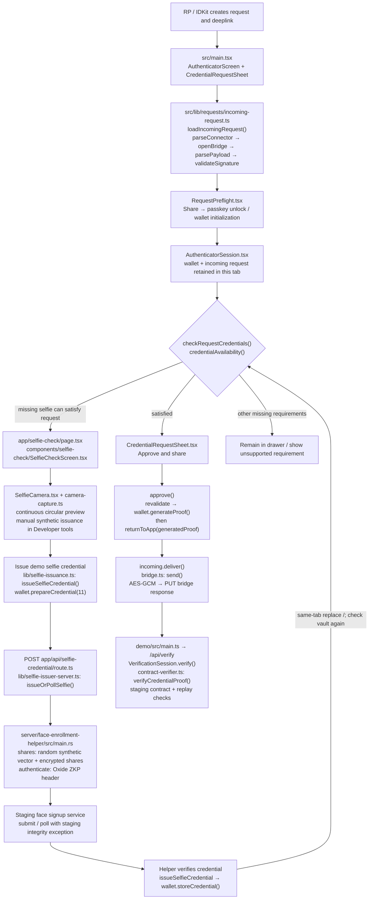
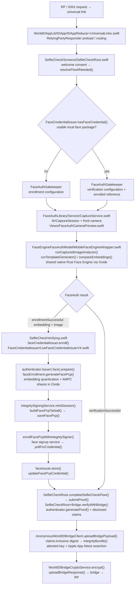
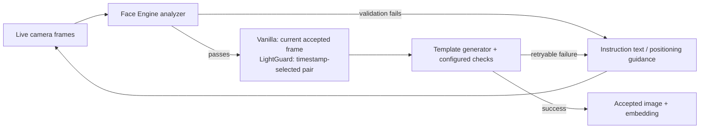

> **Historical demo/integration notes.** Synthetic enrollment and the TEE demo
> are preserved under `experiments/tee-demo`; they are not part of the default app.
> Paths and validation below describe that earlier implementation. For current
> runtime boundaries and readiness, see [code boundaries](code-boundaries.md).

# Selfie Check: browser demo versus iOS

Source review: October 1, 2026. Browser diagrams describe this working tree,
including automatic proof delivery after approval. iOS diagrams describe the
local `world-app-ios` checkout's external v4 Selfie Check flow, not its sandbox
outcomes, Mini Apps, or DeepFace challenge flow. No iOS build was run.

## Browser demo: concrete code path

Unsupported presence/identity-attestation requirements remain blocked. A request
with a usable alternative credential does not need selfie enrollment. An active
selfie credential outside the RP's date bounds is not repaired by this demo issuer.

The browser receives a real signed staging credential and produces a real proof,
but enrollment input is synthetic. Missing-credential setup keeps a circular camera
preview live until interrupted. It does not take a photo or automatically issue a
credential. Developer tools offer manual synthetic issuance. Video is not saved,
uploaded or used by the issuer. There is no face embedding derived from the
image, live-face verification, Face PCP, or Flamingo call in this path. The
source's image/model metadata does not mean inference ran.

The issuer helper runs in a localhost server process, not browser WASM. The
response capability and unlocked wallet survive internal navigation through the
root session provider; they do not survive a reload. Failed proof delivery retains
the generated proof for an explicit retry, without enrolling or generating again.

## iOS: concrete code path

Most feature paths below are under `Sources/WorldAppLegacy/Sources/`;
`FaceAuthLibrary` is a separate package under `Sources/FaceAuthLibrary/`.

For this external v4 flow, iOS continues from enrollment/face verification into
proof generation and delivery automatically. It does not require this demo's
separate post-enrollment proof-approval drawer. Failed delivery can be retried
without repeating enrollment. The native retry path can rebuild the proof from
the retained request; our browser retry resends the already-generated proof.

iOS returns `userPresenceCompleted: true` after the face flow and binds disclosed
claims into its integrity digest. Its v4 bridge client fails if integrity bundle
generation fails. Our browser currently sends no equivalent integrity bundle and
does not claim completed user presence. The RP's verification service is outside
the iOS app; choosing its endpoint is an RP integration decision.

## Broad systems and the decided browser target

```mermaid
flowchart TD
    subgraph Current["Browser demo today"]
        B["Browser<br/>passkey + WalletKit WASM<br/>credential storage + proofs"]
        H["Local Next.js server + Rust helper<br/>synthetic enrollment input"]
        S["Staging face signup service"]
        BR["World ID bridge → demo RP<br/>direct staging-contract verification"]
        B -->|missing credential| H --> S
        S -->|signed credential| B
        B -->|encrypted proof response| BR
    end
    subgraph Native["iOS Selfie Check today"]
        I["iOS device<br/>camera + Face Engine + Oxide<br/>embedding, shares, PCP + WalletKit"]
        A["Integrity service / App Attest"]
        IS["Face signup service"]
        IR["World ID bridge → RP verifier"]
        I <-->|enrollment / response evidence| A
        I -->|encrypted shares + bound enrollment| IS
        IS -->|signed credential| I
        I -->|proof + integrity bundle, bridge-encrypted| IR
    end
    subgraph Target["Decided browser architecture — not implemented"]
        W["Browser<br/>camera + guidance + WalletKit<br/>encrypted channel + PCP custody"]
        T["Flamingo TEE<br/>authoritative model checks / embedding<br/>quantize, generate and encrypt shares<br/>attest bound output"]
        TS["Face signup service<br/>verify TEE evidence before acceptance"]
        WR["World ID bridge → RP verifier<br/>accepted response-integrity contract still needed"]
        W -.->|images encrypted to a verified enclave key| T
        T -.->|bound enrollment output; submission route TBD| TS
        T -.->|user-encrypted custody data| W
        TS -.->|signed credential| W
        W -.->|proof + agreed integrity evidence| WR
    end
```

TEE image encryption is separate from bridge response encryption. The latter
already works in our demo; it does not establish a trusted channel to an enclave.
Moving embedding/share generation to the TEE does not by itself prove camera
provenance or solve RP response integrity. Promon integration remains separate
work; this diagram does not claim a deployed Promon evidence contract.

## The five material differences

| Area             | Browser today                                              | iOS                                                         | Browser target                                                                               |
| ---------------- | ---------------------------------------------------------- | ----------------------------------------------------------- | -------------------------------------------------------------------------------------------- |
| Returning user   | Existing credential goes straight to proof approval        | Live face verification against enrolled reference           | Add live capture and the agreed TEE reference check                                          |
| First enrollment | Local helper generates synthetic input                     | Device generates real embedding and shares                  | TEE generates real embedding and shares                                                      |
| Custody          | Encrypted credential vault, no Face PCP                    | Encrypted Face PCP and credential association               | Portable PCP custody APIs + browser persistence/recovery                                     |
| Evidence         | Staging admission exception; no response integrity bundle  | Enrollment integrity session and response App Attest bundle | TEE enrollment evidence plus a separately agreed web response-integrity solution             |
| User flow        | Share → optional demo issuance → approve proof → auto-send | Consent → capture/verify or enroll → auto-submit proof      | Same-tab capture/enrollment continuation; final approval policy can be simplified separately |

## Source entry points

- Browser request/UI: [CredentialRequestSheet](../src/components/CredentialRequestSheet.tsx),
  [SelfieCheckScreen](../src/components/selfie-check/SelfieCheckScreen.tsx),
  [incoming request](../src/lib/requests/incoming-request.ts),
  [bridge](../src/lib/requests/bridge.ts).
- Browser issuance: [issueSelfieCredential](../src/lib/selfie-issuance.ts),
  [server adapter](../src/lib/selfie-issuer-server.ts),
  [native helper](../src/server/face-enrollment-helper/src/main.rs).
- iOS flow: [SelfieCheckRoot](../../world-app-ios/Sources/WorldAppLegacy/Sources/SelfieCheck/Screens/SelfieCheckRoot.swift),
  [v4 issuer](../../world-app-ios/Sources/WorldAppLegacy/Sources/FaceCredentialIssuer/LiveFaceCredentialIssuerV4.swift),
  [proof and claims](../../world-app-ios/Sources/WorldAppLegacy/Sources/SelfieCheck/Screens/SelfieCheckRoot+Bridge.swift),
  [integrity and transport](../../world-app-ios/Sources/WorldAppLegacy/Sources/RelyingPartyResponderCore/WorldIDBridge/AnonymousWorldIDBridgeClient.swift).
- Planned upstream work: [WASM/upstream plan](wasm-upstream-plan.md).

## What chooses the iOS capture

The camera produces a video stream. `CaptureService.SampleBufferDelegate` uses
`bufferingNewest(1)`; `FaceAuthVerificationReducer` skips incoming frames while
an image is being processed and waits for camera reveal/startup readiness before
analysis. This avoids accumulating an old-frame processing queue.

- **Vanilla:** the accepted `subjectFace` and its `currentImageProcessed` feed the
  template generator. Successful enrollment returns that image and embedding.
  The UI does not take an unrelated second still photo after analysis.
- **LightGuard:** after framing/stability checks, the app captures a sequence
  while changing screen illumination. `categorizeLightGuardFrames()` considers
  exposure and screen-presentation timing and separates frames that overlap the
  transition. It selects `illuminated.last` and `unilluminated.first`. Configuration
  chooses which accepted image feeds identity embedding generation. Frame counts,
  startup delays and stability settings depend on the selected configuration;
  source defaults are not proof of deployed settings.
- **Ownership:** iOS `FaceAuthLibrary` owns capture timing, frame selection and
  instruction presentation. Shared native Face Engine supplies analyzer/model
  results through Oxide bindings. WalletKit does not select camera frames.

References: [stream buffering](../../world-app-ios/Sources/FaceAuthLibrary/Sources/FaceAuthLibrary/Service/CaptureService.swift),
[capture reducer](../../world-app-ios/Sources/FaceAuthLibrary/Sources/FaceAuthLibrary/Screens/FaceAuthVerification/FaceAuthVerificationReducer.swift),
[LightGuard frame selection](../../world-app-ios/Sources/FaceAuthLibrary/Sources/FaceAuthLibrary/Screens/FaceAuthVerification/FaceAuthVerificationState.swift).

## Credential expiry versus a fresh selfie check

The selfie credential already contains a signed `expires_at`. The owner of that
value is `signup-service-credential-signer`, not the browser or camera code.
`CredentialService::generate_credential()` calls `calculate_expiry()` using
`CREDENTIAL_EXPIRY_DAYS`; the current implementation rounds to UTC midnight on
the resulting date. Checked-in face deployment values on main specify **90 days**
for both staging and production. Runtime overrides were not inspected.

Changing this policy requires an issuer-side change and applies to newly signed
credentials. A browser cannot edit the expiry of an existing signed credential.
Minute-level lifetimes also require changing the current day-based calculation.
WalletKit stores the expiry and excludes expired credentials; the verifier must
enforce the required validity bounds too.

Three different lifetimes must stay separate:

| Lifetime                         | Owner / meaning                                                                                                                                       |
| -------------------------------- | ----------------------------------------------------------------------------------------------------------------------------------------------------- |
| Credential expiry                | Issuer-signed enrollment credential validity; currently 90-day checked-in face policy                                                                 |
| Proof request / challenge expiry | How long an RP request can be completed; the local Zoom checkout sets its challenge window to 2 hours                                                 |
| Live-check freshness             | How recently a face check happened for the current operation; requires accepted request-bound evidence, not merely an unexpired enrollment credential |

Zoom's 24-hour DynamoDB TTL is record cleanup, not selfie credential expiry.
If the requirement is to see the user's face again on each request, retain the
enrollment credential and perform a fresh bound face check, as the iOS flow does.
Deleting credentials on a browser timer cannot provide that assurance.

References: [signer calculation](https://github.com/worldcoin/signup-service-credential-signer/blob/main/src/services/credential_service.rs),
[staging face config](https://github.com/worldcoin/signup-service-credential-signer/blob/main/deploy/stage/orb-stage-v2-eu-central-1/values-face-signup-service-credential-signer.yaml),
[production face config](https://github.com/worldcoin/signup-service-credential-signer/blob/main/deploy/prod/orb-prod-v2-eu-central-1/values-face-signup-service-credential-signer.yaml),
[WalletKit expiry filtering](../../../walletkit/crates/walletkit-core/src/storage/credential_vault/mod.rs),
[Zoom lifetime constants](../../world-id-zoom/src/lib/constants.ts).
